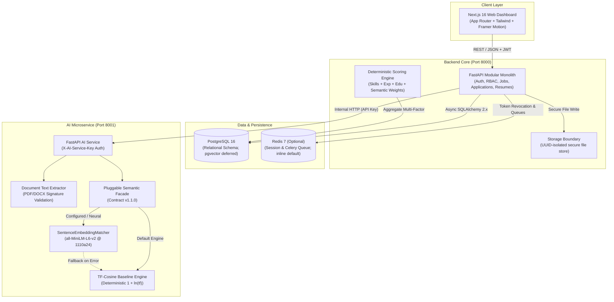

# CareerSync AI — Automated Recruitment Intelligence & Candidate Ranking

<div align="center">

[](https://www.python.org/downloads/release/python-3110/)
[](https://nextjs.org/)
[](https://fastapi.tiangolo.com)
[](https://www.postgresql.org/)
[](https://github.com/CareerSyncAI/AI-Job-Matcher/actions/workflows/ci.yml)
[](https://opensource.org/licenses/MIT)

**An explainable, deterministic recruitment intelligence platform pairing rule-grounded candidate evaluation with pluggable neural semantic search.**

[Quick Start](#-quick-start) • [System Architecture](#-system-architecture) • [Pluggable Similarity Engines](#-pluggable-similarity-engines) • [Evaluation Benchmark](#-evaluation-benchmark) • [Documentation](docs/README.md)

</div>

---

## 📌 Executive Overview

Modern recruitment systems frequently suffer from two opposing failure modes: brittle keyword filters that reject qualified candidates for phrasing differences, and generative "black-box" AI tools that hallucinate candidate qualifications and introduce undetectable bias.

**CareerSync AI** resolves this dilemma with an **explainable, multi-factor ranking architecture**:
1. **Deterministic Multi-Factor Scoring**: Candidate match scores are computed using transparent weighted scoring ($S_{\text{skills}}$, $S_{\text{exp}}$, $S_{\text{edu}}$, $S_{\text{sem}}$) where every claim is strictly grounded in verifiable resume text.
2. **"Uncertainty-First" Tier Ordering**: Missing mentions in resumes are classified as `not_detected` (Tier 2) rather than penalizing them as confirmed disqualifications (`gap`, Tier 3).
3. **Pluggable Dual-Engine Semantic Analysis**: Supports both a zero-dependency deterministic sublinear TF-Cosine baseline and a dense vector contextual embedding matcher (`sentence-transformers/all-MiniLM-L6-v2`) with explicit fallback guarantees.
4. **Verbatim Evidence Anchoring**: Zero hallucinated competencies. Every matched skill references exact character offsets and verbatim document quotes.
5. **Candidate Privacy & Identity Protection**: Recruiter uploads cannot mutate or hijack registered candidate accounts, and internal scoring weights are strictly redacted from candidates.

> **Evaluation Transparency Notice**: CareerSync AI provides deterministic decision support for human recruiters. It does not replace human recruiter judgment and does not output automated hiring decisions or "hire probabilities."

---

## 🏛️ System Architecture



---

## 🧠 Pluggable Similarity Engines (v1.1.0)

CareerSync AI decouples semantic analysis into a modular engine facade complying with **API Contract v1.1.0**:

| Dimension | Deterministic Baseline (`baseline`) | Dense Vector Embedding (`embedding`) |
| :--- | :--- | :--- |
| **Model** | Sublinear TF-Cosine ($1 + \ln(\text{tf})$) | `sentence-transformers/all-MiniLM-L6-v2` |
| **Immutable Revision** | N/A (Algorithmic / Code) | `1110a243fdf4706b3f48f1d95db1a4f5529b4d41` |
| **Vector Dimension** | Vocabulary size (sparse) | 384 dimensions (dense) |
| **Inference Latency** | < 1 ms (instantaneous) | ~40 ms (warm CPU inference) |
| **Cold-Start Time** | 0.0 seconds | ~7 seconds (one-time thread-safe load) |
| **External Dependencies**| Zero external ML libraries | PyTorch + sentence-transformers |
| **Chunking Strategy** | Full-document token boundaries | Section-aware bounded (≤ 500 chars) |
| **Failure Mode** | Pure deterministic math | Automatic fallback to `baseline` |
| **Production Default** | **Active (Default)** | Selectable via `SEMANTIC_MATCHER` |

### Uncalibrated Decision Support & Production Ranking Separation
- **Production Recruiter Ranking**: In the live application, candidate ranking in the recruiter dashboard is computed **100% deterministically** by `DeterministicEvaluationEngine` using canonical taxonomy extractions and the `SublinearTFCosineMatcher` ($1 + \ln(\text{tf})$).
- **AI Microservice Semantic Scores**: The neural dense vector model (`all-MiniLM-L6-v2`) in `ai-services` is currently a standalone semantic inference service under Contract v1.1.0 providing **diagnostic and exploratory** semantic similarity scores. It does **not** currently override the backend's deterministic recruiter ranking.
- **Uncalibrated Signal**: The similarity API returns `raw_similarity` as mathematical cosine similarity $[-1.0, 1.0]$. It is an uncalibrated decision-support signal, **never** a hiring probability or candidate confidence score.

---

## 📊 Exploratory Semantic Similarity Benchmark

The AI microservice includes a curated 30-pair comparative evaluation benchmark (`ai-services/fixtures/evaluation/evaluation_benchmark.json`) partitioned into balanced `dev` (15 pairs) and `held_out_test` (15 pairs) splits across 8 role families.

> **Important Scope & Methodology Note**: This benchmark measures **pairwise ordinal consistency** across isolated text pairs (evaluating whether a known more-relevant candidate-job pair receives a higher similarity score than a less-relevant pair). It is an exploratory semantic similarity metric on a 30-pair sample; it is **not** an evaluation of multi-candidate job ranking quality across real recruiter applicant pools.

| Evaluation Metric | Baseline (TF-Cosine) | Embedding (all-MiniLM-L6-v2) | Context / Notes |
| :--- | :---: | :---: | :--- |
| **Held-Out Pairwise Consistency** | 85.71% | **94.81%** | 15-pair held-out split (evaluating relative ordering) |
| **Overall Pairwise Consistency** | 86.69% | **94.16%** | 30-pair combined benchmark |
| **Relevant vs. Borderline Margin**| +0.211 | **+0.328** | Separation between relevant and borderline matches |
| **Negative Control Discrimination**| 15.0 / 100 | 18.0 / 100 | Mean score on irrelevant domain pairs (scored below all relevant pairs) |
| **Sample Size** | 30 pairs | 30 pairs | Exploratory benchmark (15 dev, 15 held-out) |

---

## 📂 Repository Layout

```text
AI-Job-Matcher/
├── .github/
│   └── workflows/ci.yml           # CI workflow (Backend, AI Services, Frontend)
├── ai-services/                   # FastAPI AI microservice
│   ├── fixtures/evaluation/       # Curated 30-pair evaluation benchmark
│   ├── src/                       # Extraction, similarity engines, and API schemas
│   ├── tests/                     # 39 passing Pytest unit & regression tests
│   ├── evaluate_similarity_models.py # Comparative evaluation harness
│   └── smoke_test_embedding.py   # CPU inference validation script
├── backend/                       # FastAPI backend monolith
│   ├── alembic/                   # PostgreSQL schema migrations (single head)
│   ├── app/                       # Auth, domain routes, deterministic scoring
│   ├── tests/                     # 48 passing Pytest integration tests
│   └── pyproject.toml             # Backend dependencies and Poetry configuration
├── frontend/                      # Next.js 16 web application
│   ├── app/                       # App Router (Recruiter & Candidate portals)
│   ├── components/                # UI components, Kanban pipeline, scorecards
│   └── package.json               # Frontend dependencies and build scripts
├── docs/                          # Comprehensive technical documentation
│   ├── audits/                    # Independent audits and security reports
│   ├── presentations/             # Presentation decks and defense slides
│   ├── ARCHITECTURE.md            # System runtime and security boundaries
│   ├── ai-service-contract.md     # Contract v1.1.0 specification
│   ├── DATABASE.md                # PostgreSQL schema & pgvector reference
│   ├── DESIGN_SYSTEM.md           # Glassmorphism design tokens & styles
│   └── PROJECT_STATUS.md          # Live status & roadmap tracking
├── careersync-ppt/                # Node.js programmatic slide deck generator
├── run_careersync.bat             # 1-Click Windows development launcher
└── docker-compose.yml             # PostgreSQL & Redis container orchestration
```

---

## 🚀 Quick Start

### Option A: Automated 1-Click Launcher (Windows)

For local development on Windows, double-click or run:
```cmd
run_careersync.bat
```
This launcher checks virtual environments, cleans lingering port allocations, launches the FastAPI backend and Next.js frontend in dedicated terminals, and opens `http://localhost:3000` in your default browser.

---

### Option B: Manual Setup

#### 1. Start Database Services
```bash
docker compose up -d postgres redis
```

#### 2. Start Backend API (Port 8000)
```bash
cd backend
python -m venv .venv
source .venv/bin/activate  # On Windows: .venv\Scripts\activate
pip install -r requirements.txt
cp .env.example .env
alembic upgrade head
uvicorn app.main:app --port 8000 --reload
```

#### 3. Start AI Microservice (Port 8001)
```bash
cd ai-services
python -m venv .venv
source .venv/bin/activate  # On Windows: .venv\Scripts\activate
pip install -r requirements.txt
python smoke_test_embedding.py  # Verifies local CPU inference
uvicorn src.api.app:app --port 8001 --reload
```

#### 4. Start Frontend Web Dashboard (Port 3000)
```bash
cd frontend
npm install
npm run dev
```
Open [http://localhost:3000](http://localhost:3000) in your browser.

---

## 🧪 Testing & Verification

The repository enforces automated testing across all service layers:

```bash
# 1. Run Backend Pytest Suite (94 passing unit/integration tests + 5 Postgres tests)
cd backend
pytest -v

# 2. Run AI Services Pytest Suite (51 unit & contract tests)
cd ai-services
pytest -v

# 3. Run Benchmark Evaluation Harness
cd ai-services
python evaluate_similarity_models.py

# 4. Run Frontend Production Build Check
cd frontend
npm run build
```

---

## 🔒 Security & Privacy Principles

- **Zero-Storage Parsing**: Uploaded files undergo SHA-256 deduplication and are stored outside public web roots with UUID keys.
- **Argon2id Hashing**: Passwords hashed with high memory/time costs.
- **Strict Role-Based Access Control**:
  - Internal scoring weights and draft job details are accessible only by the owning recruiter.
  - Recruiter resume uploads matching existing candidate accounts are isolated to prevent profile hijacking.
- **Verbatim Evidence Anchoring**: Match explanations quote exact document character offsets, preventing generative hallucination.

---

## 👥 Authors & Academic Credits

Developed as the **5th Semester System Development Project (SGP)** for Computer Engineering.

- **Institution**: Charotar University of Science and Technology (CHARUSAT)
- **Project Repository**: [`CareerSyncAI/AI-Job-Matcher`](https://github.com/CareerSyncAI/AI-Job-Matcher)
- **Academic Decks**: Available in [`docs/presentations/`](docs/presentations/)
