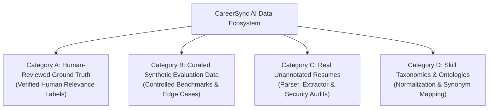

# CareerSync AI — Evaluation Data Manifest & Dataset Registry

**Status:** Official SGP Evaluation Specification  
**Version:** 2.0.0  
**Effective Date:** 26 October 2026  
**Audience:** Antigravity AI, Academic Viva Examiners, SGP Project Supervisors  

---

## 1. Overview & Categorization Philosophy

In accordance with the **CareerSync AI Revised Scope-Controlled Upgrade Plan** and Stage 2 directives, datasets must be strictly segregated by purpose, provenance, and label reliability. Under no circumstances may synthetic labels or programmatic generations be conflated with verified human recruiter ground truth.

All data utilized in CareerSync AI is partitioned into four immutable categories:

---

## 2. Dataset Registry by Category

### Category A: Human-Reviewed Ground Truth Data

#### Dataset A1: Role Radar Human Gold Benchmark (106 Pairs)
* **Local Artifact:** [`evaluation/data/role_radar_gold_108.json`](file:///c:/Users/Hit/Desktop/SGP%205TH%20Sem/AI-Job-Matcher/evaluation/data/role_radar_gold_108.json)
* **Source Repository:** `jimyones/role-radar-dataset` (Hugging Face)
* **Files Extracted:** Joined `gold_labels.json` with `synthetic_profiles.json` and `scraped_jobs.json`.
* **Scale:** Exactly **106 usable pairs** across 84 real Indian tech job postings (e.g. PwC, Stripe, high-growth startups) and 79 candidate profiles.
* **Label Provenance:**
  * **Verified Human Evaluators:** Scored independently across skills, seniority, domain, location fit, and overall composite score ($0–100$), accompanied by qualitative human reasoning.
  * Mapped to CareerSync AI 4-tier ordinal relevance scale ($\ge 80 \rightarrow 3$, $55–79 \rightarrow 2$, $20–54 \rightarrow 1$, $< 20 \rightarrow 0$).
* **Licensing:** Apache 2.0 (Open research access).
* **Role in CareerSync AI:** Primary human benchmark for rank correlation and human alignment validation.
* **PII & Redistribution:** Cleansed of personal identifiers; safe for academic evaluation.

---

### Category B: Curated Synthetic Evaluation Data

#### Dataset B1: CareerSync SGP 120-Pair Curated Benchmark
* **Local Artifact:** [`evaluation/data/evaluation_corpus.json`](file:///c:/Users/Hit/Desktop/SGP%205TH%20Sem/AI-Job-Matcher/evaluation/data/evaluation_corpus.json)
* **Validation Schema:** [`evaluation/schemas/evaluation_pair.schema.json`](file:///c:/Users/Hit/Desktop/SGP%205TH%20Sem/AI-Job-Matcher/evaluation/schemas/evaluation_pair.schema.json)
* **Protocol Reference:** [`docs/STAGE_2_EVALUATION_PROTOCOL.md`](file:///c:/Users/Hit/Desktop/SGP%205TH%20Sem/AI-Job-Matcher/docs/STAGE_2_EVALUATION_PROTOCOL.md)
* **Scale:** **120 candidate-job pairs** across **15 distinct jobs** (8 candidates per job, covering 5 engineering tracks).
* **Label Provenance (Audit Finding):**
  * **PROGRAMMATICALLY GENERATED:** Built via [scratch/generate_corpus.py](file:///c:/Users/Hit/Desktop/SGP%205TH%20Sem/AI-Job-Matcher/scratch/generate_corpus.py) using controlled technical job blueprints and candidate competency profiles.
  * **NOT Independent Human Ground Truth:** While designed to reflect realistic hiring distributions (30 Strong, 45 Partial, 30 Weak, 15 Insufficient), the labels were assigned programmatically by blueprint logic, not by independent recruiter double-blind review.
* **Zero Leakage Partitioning:**
  * **Development Split (40%):** 6 jobs (`JOB-DEV-01` to `06`), 48 pairs. Available for calibration and inspection.
  * **Held-Out Split (60%):** 9 jobs (`JOB-HELD-07` to `15`), 72 pairs. **Strictly frozen**.
* **Role in CareerSync AI:** Controlled stress-testing of baseline vs. embedding matchers on long documents, late achievements, and edge cases.

#### Dataset B2: Candidate Matching Synthetic (Ozon Benchmark)
* **Local Artifact:** [`evaluation/data/candidate_matching_synthetic_matches.parquet`](file:///c:/Users/Hit/Desktop/SGP%205TH%20Sem/AI-Job-Matcher/evaluation/data/candidate_matching_synthetic_matches.parquet)
* **Source Repository:** `michaelozon/candidate-matching-synthetic` (Hugging Face)
* **Scale:** Modular synthetic candidate-job requisition records.
* **Label Provenance:** Generative programmatic heuristics simulating supply-demand seniority.
* **Licensing:** MIT License.
* **Role in CareerSync AI:** Extreme edge-case regression validation (e.g., zero overlapping skills, extreme tenure gaps).

---

### Category C: Real Unannotated Resumes for Extraction Audits

#### Dataset C1: Kaggle Real Resume Corpus
* **Local Location:** `C:\Users\Hit\Downloads\Resume.csv\Resume.csv` (2,484 real resumes across 24 categories)
* **Script Integration:** [`ai-services/eval_real_resumes.py`](file:///c:/Users/Hit/Desktop/SGP%205TH%20Sem/AI-Job-Matcher/ai-services/eval_real_resumes.py)
* **Label Provenance:** Resumes only; categorised by profession (`INFORMATION-TECHNOLOGY`, `ENGINEERING`, `FINANCE`, etc.).
* **Limitation:** **NO job descriptions and NO candidate-job relevance labels**.
* **Role in CareerSync AI:** Document parser validation, layout robustness, real-world skill extraction, tenure calculation, and security audits (zip-bomb, page-limit checks). **NOT used for ranking evaluation.**

---

### Category D: Skill Taxonomies & Ontologies

#### Dataset D1: European Skills, Competences, Qualifications and Occupations (ESCO v1.2)
* **Source:** European Commission Official Portal (`https://esco.ec.europa.eu/en/use-esco/download`)
* **Scale:** 13,900+ standardized skills and multilingual synonyms.
* **Licensing:** ODbL / CC BY 4.0 terms.
* **Role in CareerSync AI:** Skill normalization, canonical alias resolution, and hierarchical family mapping.

#### Dataset D2: TechWolf SkillMatch-1K Benchmark
* **Local Artifact:** [`evaluation/data/skillmatch_1k_test.csv`](file:///c:/Users/Hit/Desktop/SGP%205TH%20Sem/AI-Job-Matcher/evaluation/data/skillmatch_1k_test.csv)
* **Source Repository:** `TechWolf/SkillMatch-1K` (Hugging Face)
* **Scale:** **1,000 skill pairs** with binary ground-truth skill relatedness (`True` / `False`).
* **Licensing:** MIT License.
* **Role in CareerSync AI:** Evaluating transferable skill rules and skill embedding semantic proximity (e.g. `OpenMP` $\times$ `MPI`, `Qualys` $\times$ `Tenable`).

---

## 3. PII & Ethical Governance Rules

1. **Zero Raw Private Resume Storage in Git:** No raw candidate resumes containing telephone numbers, private emails, or home addresses may ever be committed to git.
2. **Volatile In-Memory Processing:** In accordance with CareerSync AI security specifications, candidate text during neural embedding inference remains transient and in-memory.
3. **Verbatim Evidence Anchoring:** Every positive evidence status (`supported`) must link to an observable, uncorrupted quotation in the candidate profile.
4. **Candidate Fairness:** An unmentioned skill must always receive `status: "not_detected"` and `is_confirmed_gap = false`. Absence of mention is never proof of candidate deficiency.
