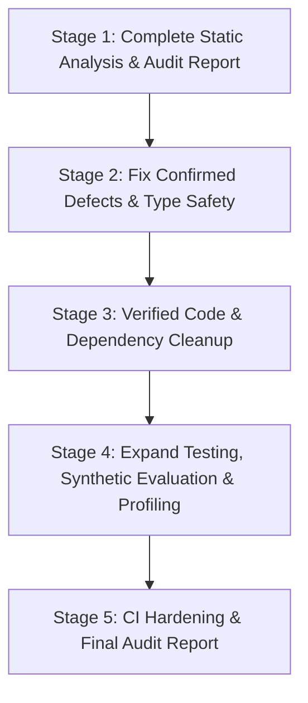

# CareerSync AI — Comprehensive Code Quality, Testing, Cleanup and Optimization Plan

**Document:** `CAREERSYNC_AI_AUDIT_PLAN.md`  
**Repository:** `CareerSyncAI/AI-Job-Matcher` (`c:\Users\Hit\Desktop\SGP 5TH Sem\AI-Job-Matcher`)  
**Git Branch:** `docs/prompt-10-demo-evidence-pack`  
**Current HEAD Commit:** `d7d9e9c` (*docs(prompt-10): correct evidence pack -- accurate env vars, verification labels, build result, demo account caveats*)  
**Working Tree Status:** Clean on tracked files (3 untracked prompt documents preserved: `CareerSync_AI_Antigravity_Prompts.md`, `CareerSync_AI_Prompt_1_Read_Only.md`, `CareerSync_AI_Revised_Roadmap.md`)  
**Date:** October 25, 2026  
**Auditor / Agent:** Antigravity (Google DeepMind)

---

## 1. Executive Summary & Objective

The primary objective is to execute a rigorous, controlled engineering audit and cleanup of **CareerSync AI**, an AI-assisted resume screening and candidate ranking application. Rather than executing unverified mass deletions or arbitrary refactorings, this work strictly adheres to:
1. **Evidence-First Safety:** Deterministic static analysis and automated test suites are executed first to establish verified empirical baselines before any modification.
2. **Preservation of Invariants:** The **100% deterministic recruiter ranking engine** (`SublinearTFCosineMatcher`, coverage tiers, degree hierarchy, experience deduplication) remains the authoritative decision-support system. The dense neural similarity model (`all-MiniLM-L6-v2` under Contract v1.1.0) remains strictly diagnostic and exploratory.
3. **No Assumptions:** Code and dependencies flagged by static tools (such as Knip, Ruff, or Pyright) are investigated against all entry points, dynamic loaders, and contracts before removal.
4. **Local-First & Cost-Efficient:** Deterministic local tools are prioritized, minimizing agent token load and avoiding unnecessary paid cloud subscriptions.

---

## 2. Repository Structure & Service Boundaries

CareerSync AI is organized as a three-tier modular architecture:

```text
c:\Users\Hit\Desktop\SGP 5TH Sem\AI-Job-Matcher\
├── backend/                  # FastAPI Modular Monolith (Python 3.11)
│   ├── alembic/              # Relational schema migrations (0001_initial_schema, 0002_add_eval_config_hash)
│   ├── app/
│   │   ├── api/v1/           # Endpoints: auth, resumes, jobs, applications, evaluation
│   │   ├── core/             # Configuration, logging, settings
│   │   ├── db/               # Session management & engine initialization
│   │   ├── evaluation/       # Benchmark runner & synthetic evaluation schema
│   │   ├── models/           # SQLAlchemy 2.0 ORM models & enums
│   │   ├── schemas/          # Pydantic v2 validation contracts
│   │   ├── security/         # JWT tokens & Argon2 password hashing
│   │   ├── services/         # Deterministic scoring, ATS analysis, taxonomy, extraction
│   │   └── workers/          # Celery worker stubs (optional background processing)
│   ├── tests/                # 11 pytest test suites (98 unit/integration tests)
│   └── requirements.txt      # Backend runtime & test dependencies
│
├── ai-services/              # Standalone NLP & Extraction Service (FastAPI, port 8001)
│   ├── src/
│   │   ├── api/              # Contract v1.1.0 HTTP endpoints (/normalize-skills, /extract-entities, /semantic-match)
│   │   ├── extractors/       # Skill, experience, education regex & rule-based extractors
│   │   ├── normalizers/      # Taxonomy normalization
│   │   ├── parsers/          # pdfplumber/pypdf and python-docx document security parsers
│   │   └── similarity/       # Baseline TF-IDF & diagnostic sentence-transformers (all-MiniLM-L6-v2)
│   ├── tests/                # 9 pytest test suites (51 unit/contract tests)
│   └── requirements.txt      # AI service runtime dependencies (PyTorch CPU, Transformers)
│
├── frontend/                 # Next.js 16 App Router (React 19, TypeScript, Tailwind CSS v4)
│   ├── src/
│   │   ├── app/              # Routes: login, register, dashboard (jobs, resume, applications, recruiter)
│   │   ├── components/       # UI Shell, header, custom SVG icons, route guards
│   │   └── lib/              # Axios client, auth context, theme provider
│   ├── package.json          # Dependencies & scripts (dev, build, lint)
│   └── tsconfig.json         # TypeScript strict configuration
│
├── docs/                     # Architecture, API specs, audits, and evaluation plans
│   ├── audits/               # Audit records and security assessments
│   └── ARCHITECTURE.md       # Ground-truth architectural specifications
└── .github/workflows/ci.yml  # Multi-platform CI pipeline (Backend, AI Services, Frontend, Postgres Integration)
```

---

## 3. Baseline Verification Report (Phase 0 Execution)

The following baseline checks were executed on the unmodified repository on October 25, 2026.

| Check | Target | Command Executed | Exit Code | Result | Key Details |
| :--- | :--- | :--- | :---: | :---: | :--- |
| **Backend Unit & Integration Tests** | `backend/` | `$env:CAREERSYNC_JWT_SECRET="ci-test-jwt-secret-minimum-32-chars-long"; $env:CAREERSYNC_ENVIRONMENT="development"; $env:CAREERSYNC_AUTO_SEED_DEMO_DATA="false"; $env:CAREERSYNC_AI_SERVICE_URL="http://localhost:8001"; $env:CAREERSYNC_AI_SERVICE_API_KEY="ci-test-ai-key"; $env:PYTHONPATH="."; .\.venv\Scripts\python.exe -m pytest -v` | **0** | **PASS** | **98 passed**, 5 skipped (Postgres migration tests require live PG instance, run on SQLite locally), 6 deprecation warnings. |
| **Backend Code Coverage** | `backend/` | `pytest --cov=app --cov-report=term-missing -q` | **0** | **PASS** | **87% overall coverage** (3,253 statements, 431 missed). Critical modules scored high (`scoring.py`: 90%, `evaluation.py`: 92%, `taxonomy.py`: 99%). |
| **AI Services Pytest Suite** | `ai-services/` | `$env:AI_SERVICE_API_KEY="ci-test-ai-key"; .\.venv\Scripts\python.exe -m pytest -v` | **0** | **PASS** | **51 passed**, 0 failed, 5 deprecation warnings. |
| **Frontend ESLint** | `frontend/` | `npm run lint` | **0** | **PASS** | Clean run with exit code 0. |
| **Frontend Type Checking** | `frontend/` | `npx tsc --noEmit` | **0** | **PASS** | Clean run with exit code 0. |
| **Frontend Production Build** | `frontend/` | `npm run build` | **0** | **PASS** | Compiled in 513ms via Next.js Turbopack, all 14 routes statically generated. |
| **Backend Ruff Linter** | `backend/` | `.\.venv\Scripts\ruff.exe check .` | **1** | **FAIL (82 errors)** | 82 violations: 57 autofixable (unused imports F401, unsorted imports I001, unused local variables F841, blind exception assertions B017). |
| **AI Services Ruff Linter** | `ai-services/` | `..\backend\.venv\Scripts\ruff.exe check .` | **1** | **FAIL (260 errors)** | 260 violations: 203 autofixable (UP006 `Dict` vs `dict`, UP007 `Union`, unused imports F401, import order I001). |
| **Backend Pyright Type Check** | `backend/` | `npx pyright backend/app` | **1** | **FAIL (16 errors)** | **High Severity Defect Identified:** `app/api/v1/resumes.py:344` uses `Job` before local import on line 349. `app/services/resumes.py:62` uses `UUID` without import. |
| **AI Services Pyright Type Check** | `ai-services/` | `npx pyright ai-services/src` | **1** | **FAIL (22 errors)** | Built-in `any` used instead of `typing.Any` across 6 extractor files; `Tuple` missing in `education_extractor.py:63`. |
| **Frontend Knip Unused Code** | `frontend/` | `npx knip` | **1** | **FAIL** | 1 unused file (`src/components/Header.tsx`), 4 unreferenced packages (`clsx`, `framer-motion`, `lucide-react`, `tailwind-merge`), 5 unused exports. |
| **Frontend Dependency Audit** | `frontend/` | `npm audit` | **1** | **FAIL (1 High)** | 1 High severity advisory in transitive dev-dependency `zod <4.6.6` (under `eslint-config-next` -> `eslint-plugin-react-hooks`). |
| **Code Duplication Analysis** | Whole repo | `npx jscpd backend/app ai-services/src frontend/src --threshold 10` | **0** | **COMPLETED** | 76 files analyzed (17,485 lines). 72 duplication clones detected (5.69%), primarily in SVG icon definitions (`Icons.tsx`) and auth views. |

---

## 4. Execution Stages & Methodology

The work will proceed strictly across five disciplined stages:



### Stage 1 — Complete Static Analysis & Audit Baseline (Report Only)
- Document all findings into `docs/audits/REPOSITORY_QUALITY_AUDIT.md`.
- Categorize each item by unique ID, severity, confidence, affected file, supporting evidence, and verification path.
- Distinguish verified defects from informational suggestions.
- **Rule:** Zero code modifications during this phase.

### Stage 2 — Fix Confirmed Defects & Type Safety
1. **Critical & High Defects:**
   - Fix `backend/app/api/v1/resumes.py:344` unbound variable `Job`.
   - Fix `backend/app/services/resumes.py:62` missing `UUID` import.
   - Fix `ai-services/src/extractors/*` type annotations (replace built-in `any` with `Any`, import missing `Tuple`).
   - Fix Pyright schema mismatches and optional member accesses in `backend/app/api/v1/jobs.py`.
2. **Regression Verification:**
   - Run backend and AI services pytest suites after each targeted batch.

### Stage 3 — Verified Code, File & Dependency Cleanup
1. **Python Cleanup:**
   - Remove unused imports (F401) and unused variables (F841) flagged by Ruff.
   - Format and sort import blocks (I001) in compliance with PEP 8.
2. **Frontend Cleanup:**
   - Confirm non-usage of `Header.tsx` (ensure no routes or layouts depend on it, verify `DashboardShell.tsx` contains its own header).
   - Evaluate unused packages (`clsx`, `framer-motion`, `lucide-react`, `tailwind-merge`) before safe removal.
   - Address `zod` security advisory via `npm audit fix` without upgrading Next.js or React versions.
3. **Verification:**
   - Re-run `npm run lint`, `npx tsc --noEmit`, `npm run build`, and `npx knip`.

### Stage 4 — Testing Expansion & AI Evaluation
1. **Synthetic Evaluation Dataset:**
   - Execute benchmark evaluation runs in `backend/app/evaluation/benchmark_runner.py` and `ai-services/eval_real_resumes.py`.
   - Record NDCG@k and Precision@k metrics across existing fixtures.
   - Confirm deterministic repeatability across consecutive runs.
2. **API & Edge Case Validation:**
   - Validate auth rate-limiting, token invalidation, role boundaries, and file upload size/type constraints.

### Stage 5 — CI Hardening & Final Documentation
1. **GitHub Actions (`ci.yml`):**
   - Incorporate Ruff linting and Pyright type-checking steps into CI jobs.
   - Add frontend Knip and npm audit gates where safe and non-blocking.
2. **Final Deliverable:**
   - Generate `docs/audits/CAREERSYNC_AI_FINAL_AUDIT_REPORT.md` recording all changes, diffs, before-and-after metrics, and verified invariants.

---

## 5. Architectural Invariants (Non-Negotiable)

1. **Deterministic Recruiter Ranking:**
   - `DeterministicEvaluationEngine` (`backend/app/services/evaluation.py` and `scoring.py`) drives authoritative scoring via `CoverageTier` ordering and sublinear TF-IDF cosine matching.
   - Under no circumstances will neural embedding scores (`all-MiniLM-L6-v2`) be substituted into authoritative candidate ranking.
2. **Diagnostic AI Boundary:**
   - `ai-services/src/similarity/embedding_matcher.py` is strictly exploratory and diagnostic under Contract v1.1.0.
3. **Verbatim Evidence Anchoring:**
   - Skills and qualifications must anchor to exact character offsets within resume text. Hallucinated skills or inferred credentials are prohibited.
4. **Data Isolation & Privacy:**
   - Recruiter uploads never mutate candidate profiles. Internal scoring weights remain private to recruiters.

---

## 6. Completion Criteria

- [x] Phase 0 baseline executed and recorded with exact command outputs.
- [ ] Phase 1 detailed audit report (`REPOSITORY_QUALITY_AUDIT.md`) published.
- [ ] All confirmed high and medium defects resolved and regression-tested.
- [ ] Verified dead code, unused imports, and unreferenced packages cleanly removed.
- [ ] Backend test suite (98 tests) and AI services suite (51 tests) pass with 100% green status.
- [ ] Frontend builds cleanly with zero TypeScript errors and zero ESLint errors.
- [ ] Final audit report (`CAREERSYNC_AI_FINAL_AUDIT_REPORT.md`) created with full execution trace.
